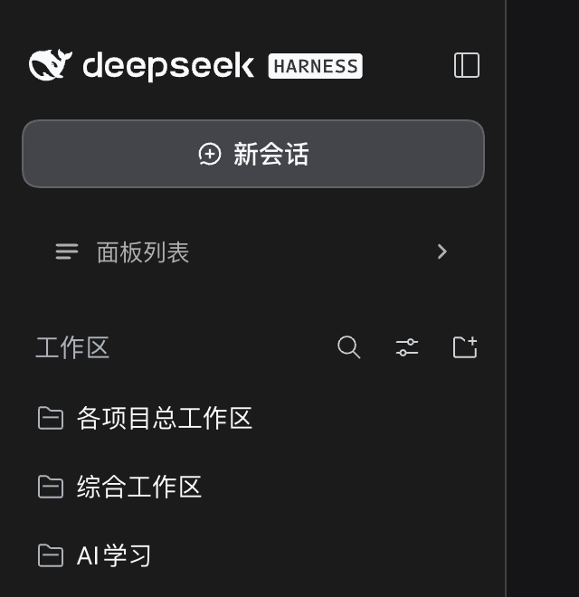

# dsh-sidebar-panel-fold

One-click fold for the DeepSeek Harness sidebar panel list.

- A new row sits at the top of the panel list: **☰ Panel list ⌄**. Click it (or press **⌥⌘P**) and the whole **Plugins … More** block collapses, so **Workspaces** moves up. Click again to restore.
- The row itself never disappears, and its caret flips to **›** while folded, so you can always open the list from the same spot.
- Shortcut: **⌥⌘P** (`Ctrl+Alt+P` on Windows/Linux), rebindable in *Settings → Keyboard shortcuts* (entry "Collapse panel list", command id `sidebar.foldPanels`).
- The folded state lives in `localStorage['dsh.sidebar-panel-fold.v1']`, so it survives a reload.



## Install

Bundle plugin: `package.json` declares `dsh.bundle.patch`, so the whole plugin installs from the repo.

```bash
pnpm dsh plugin --profile <profile> add 'github:<owner>/dsh-sidebar-panel-fold'
```

Or open the 插件 page in the GUI → 添加插件 → paste the repo URL. Restart / reload the window afterwards.

## How it works

- Folding is one attribute plus one CSS rule: `nav[data-dsh-panels-folded] > *:not([data-dsh-fold-row]) { display: none }`. The React tree the host renders is never touched; a `MutationObserver` re-applies the attribute whenever React rebuilds the list.
- The toggle is registered into the `sidebar.panellist` slot at `order: -1000`. That slot renders a registration as *one row's icon cell*, so the component sets the two intermediate wrappers to `display: contents` on mount — the button becomes a direct child of the row button, so the whole row is the click target — and stops the row's own navigation with `stopPropagation`. The row's built-in label is hidden with `:has()`.
- Accessibility: the icon cell ships `aria-hidden`, which would hide a focusable button, so it is lifted on mount and restored on unmount; the host row gets `tabindex="-1"` to avoid a second tab stop.
- The shortcut is registered through the Client `shortcuts` service (`regions: ['page', 'editable']`, so it also works while typing). If the service is missing or refuses the binding, the plugin falls back to its own ⌥⌘P listener.
- Selector fallback: if `nav.kB3qhq_panelList` is gone, the plugin looks for the left-column `nav` that contains its own toggle row.

## Files

```
package.json        # dsh.bundle.patch + dsh.client declarations
cordis.patch.yml    # insert: sidebar-panel-fold
index.js            # Host half (no-op)
client.js           # all UI behaviour
icon.svg            # plugin-list icon
docs/folded.png     # the folded sidebar
```

MIT licensed.
