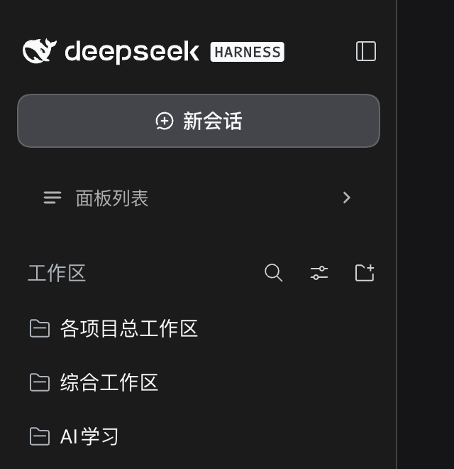

# dsh-sidebar-panel-fold

给 DeepSeek Harness Web / 桌面 UI 的侧栏加一个「折叠面板列表」的开关。

- 面板列表最上面多一行 **☰ 面板列表 ⌄**：点它（或按 **⌥⌘P**）就把 **插件 → 更多** 那一整列收起来，**工作区** 直接上移；再点一次展开。
- 收起后这一行仍然留在原位，箭头转成 **›**，所以永远能在原地把它打开。
- 快捷键：**⌥⌘P**（Windows/Linux 为 Ctrl+Alt+P），可在「设置 → 键盘快捷键」里改（条目「折叠面板列表」，命令 id `sidebar.foldPanels`）。
- 状态记在浏览器 localStorage（`dsh.sidebar-panel-fold.v1`），重开窗口保持。



## 实现要点

- 折叠只用一个属性 `data-dsh-panels-folded` 加一段包内 CSS（`nav[data-dsh-panels-folded] > *:not([data-dsh-fold-row]){display:none}`），不改 Harness 的 React 树；面板列表被 React 重建后由 `MutationObserver` 重新打标。
- 开关行注册进 `sidebar.panellist` 插槽，`order: -1000` 排在所有面板前面。这个插槽的原生行为是「注册的东西渲染成某一行的图标格」，所以组件挂载时把中间那两层包裹元素设成 `display: contents`，按钮就变成行按钮的直接子元素，整行都是点击区；行自己的标签被隐藏，点击 `stopPropagation` 掉原生跳转。
- 顺手修了可访问性：图标格原有的 `aria-hidden` 会把这个可聚焦按钮藏起来，挂载时摘掉、卸载时还原，主行 `tabindex` 设成 -1 少一个 Tab 停留点。
- 快捷键通过 `ctx.inject(['shortcuts'])` 注册（`regions: ['page','editable']`，输入框里按也生效）；服务缺席或注册被拒时退回自带的 ⌥⌘P 监听。
- 选择器带兜底：找不到 `nav.kB3qhq_panelList` 时按「左侧 + 含本插件开关行」挑 `nav`，Harness 改类名后仍能工作。

## 目录

```
package.json        # dsh.bundle.patch + dsh.client 声明
cordis.patch.yml    # insert: sidebar-panel-fold
index.js            # Host 端，空实现
client.js           # 全部 UI 行为
icon.svg            # 插件列表图标
docs/folded.png     # 折叠后的样子
```
